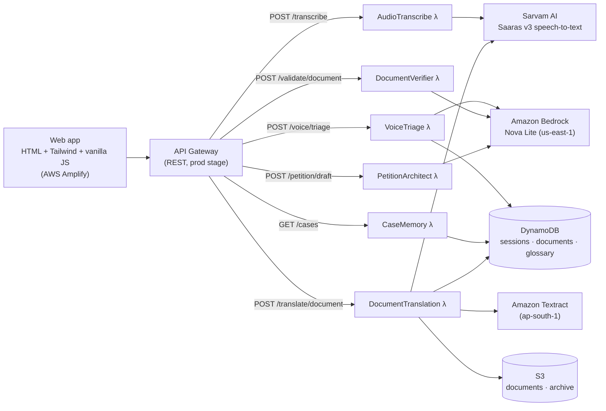

<div align="center">

# ⚖️ Nyaya-Dwarpal

**Speak your legal problem in your own language and get a plain-language answer grounded in Indian law.**

[](https://main.d1y87jb5yrv6jl.amplifyapp.com/)


[](LICENSE)

[Live demo](https://main.d1y87jb5yrv6jl.amplifyapp.com/) · [Features](#features) · [Architecture](#architecture) · [Run it yourself](#run-it-yourself) · [API](#api)

</div>

---

## Why

Most Indians do not read legal English, a lawyer's first consultation costs more than many families can spare, and the new criminal codes (BNS and BNSS, 2023) replaced the IPC and CrPC sections people had heard of. Nyaya-Dwarpal ("gatekeeper of justice") is a first stop: describe the problem by voice or text in an Indian language, and it tells you what kind of legal issue it is, which sections may apply, and what to do next.

Built for the **AI for Bharat** hackathon on a serverless AWS stack.

## Features

| | Feature | What it does |
|---|---|---|
| 🎤 | **Get Legal Help** | Speak (up to 30 seconds) or type your problem in one of 10 Indian languages. Sarvam AI's Saaras v3 turns speech into text, with automatic language detection. Amazon Nova Lite on Bedrock then gives the type of problem, urgency, the laws that may apply (citing the new **BNS / BNSS / BSA**, not the repealed IPC and CrPC), step-by-step advice, documents to keep ready, costs, timelines and free help. |
| 📝 | **Petition drafts** | Turn any case into a draft petition (facts, grounds, prayer) in your language, with [placeholders] for anything you didn't say. Copy it or download it as text. |
| 📄 | **Check a Document** | Upload a PDF, Word (.docx), photo or text file of a rental agreement, job contract or legal notice. The AI flags unfair or illegal clauses and mistakes, rated Serious / Important / Minor. Photos and scanned PDFs are read with Amazon Textract. |
| 🌐 | **Translate a Document** | Upload a `.txt` or `.pdf` and pick a language (11 options). Sarvam AI detects the source language and translates it; copy or download the result. |
| 🗂️ | **My Cases** | Every question is saved (DynamoDB, looked up through a per-user index) and shown newest first, with the full advice. Cases are tied to an anonymous ID stored on the device. No sign-up. |
| 📚 | **Legal Library** | About 50 key sections in plain English: BNS crimes, women's and family protections, police and bail rights under BNSS, consumer, work, rent and RTI law, each with the old IPC/CrPC number, plus free helplines. Searchable, works offline once loaded. |
| 🗣️ | **Six interface languages** | The whole interface is available in English, Hindi, Telugu, Tamil, Bengali and Marathi. |
| 📱 | **Phone-first** | Built for small screens and slow connections: compiled 24 KB stylesheet, no framework, and it works on Android and iPhone browsers (Safari's audio format is supported). |

## Architecture



The stack is deployed to **ap-south-2 (Hyderabad)** by default. Bedrock is called in `us-east-1` and Textract in `ap-south-1`, where those services are available.

## Tech stack

- **Frontend:** a static site in `ui/` (`index.html`, `app.js`, `i18n.js` for the six interface languages, `library.js` for the Legal Library) styled with Tailwind CSS compiled to `ui/styles.css` (`npm run build:css`). No framework. Records audio with the MediaRecorder API. Hosted on AWS Amplify (`amplify.yml` serves the `ui/` folder).
- **Backend:** six Python 3.11 AWS Lambda functions behind API Gateway, sharing a Lambda layer (`lambda_functions/shared`) for the Bedrock client, AWS helpers and Pydantic models.
- **AI:** Amazon Bedrock with `amazon.nova-lite-v1:0` for reasoning, and Sarvam AI for Indic speech-to-text and translation.
- **Data:** DynamoDB, S3 (encrypted buckets) and Textract.
- **Safety:** all AI and user text is HTML-escaped before display; the API is rate-limited (10 requests/s, burst 20) and each AI-calling Lambda has a concurrency cap (3–5) so costs stay bounded; request bodies are never logged; cases can only be read by the ID that created them.
- **Infrastructure as code:** AWS CDK v2 (Python), in `infrastructure/nyaya_dwarpal_stack.py`.

## Run it yourself

### Prerequisites

- An AWS account with the AWS CLI configured (`aws configure`)
- [Amazon Bedrock model access](https://docs.aws.amazon.com/bedrock/latest/userguide/model-access.html) to **Amazon Nova Lite** in `us-east-1`
- A [Sarvam AI](https://www.sarvam.ai/) API key
- Python 3.11 and Node.js 18+ (for the CDK CLI)

### 1. Install

```bash
git clone https://github.com/ScaryPython100/NyayaDwarpal.git
cd NyayaDwarpal

python3.11 -m venv venv
source venv/bin/activate
pip install -r requirements.txt
npm install            # installs the AWS CDK CLI locally
```

### 2. Bundle the Lambda dependencies

Lambda packages are built from local folders, so their libraries are installed next to the code (these folders are git-ignored):

```bash
pip install -r lambda_functions/shared/requirements.txt -t lambda_functions/shared/python \
  --platform manylinux2014_x86_64 --only-binary=:all: --python-version 3.11
pip install -r lambda_functions/audio_transcribe/requirements.txt -t lambda_functions/audio_transcribe/python \
  --platform manylinux2014_x86_64 --only-binary=:all: --python-version 3.11
pip install -r lambda_functions/document_verifier/requirements.txt -t lambda_functions/document_verifier \
  --platform manylinux2014_x86_64 --only-binary=:all: --python-version 3.11
```

### 3. Set your keys

```bash
cp .env.example .env   # then put your Sarvam key in .env
set -a; source .env; set +a
```

| Variable | Needed for |
|---|---|
| `SARVAM_API_KEY` | Speech-to-text and document translation |

Bedrock and Textract use your AWS credentials, so they need no key.

Keys are passed to the Lambdas as environment variables at deploy time, and `app.py` refuses to deploy without `SARVAM_API_KEY` so a deploy can never blank the live key. Never commit `.env`.

### 4. Deploy

```bash
npx cdk bootstrap      # once per account and region
npx cdk deploy         # deploys to ap-south-2; add -c region=<region> to change it
```

The deploy prints the API Gateway URL. Put it in `API_ENDPOINT` at the top of `ui/app.js`.

### 5. Open the app

Serve the folder (for example `python3 -m http.server -d ui 8000`) and open it. After changing the markup or `app.js`, rebuild the stylesheet with `npm run build:css`. To host it, connect the repo to AWS Amplify; `amplify.yml` is already set up.

### Tests

```bash
pytest tests/unit
```

The unit tests mock AWS, so they need no account or keys. `tests/` also has scripts that call a deployed API (`test_voice_triage.py`, `test_document_translator.py`, …); change their base URL to your own deployment first.

## API

Base URL: the `prod` stage URL printed by `cdk deploy`.

| Method | Path | Body / query | Returns |
|---|---|---|---|
| `POST` | `/transcribe` | `{ audio (base64), mime_type, language_code }` (`unknown` = detect) | Transcript and detected language |
| `POST` | `/voice/triage` | `{ userId, transcribedText, language, useNativeScript }` | Category, urgency, emotion, BNS sections, advice, next steps |
| `POST` | `/validate/document` | `{ document (base64), fileType, fileName }` | Issues rated HIGH / MEDIUM / LOW |
| `POST` | `/translate/document` | `{ userId, fileContent (base64), filename, targetLanguage }` | Original and translated text |
| `GET` | `/cases` | `?userId=user-…&limit=<n ≤ 50>` | That user's cases, newest first |
| `POST` | `/petition/draft` | `{ facts, category, sections, language, issueText }` | Facts, grounds and prayer sections |
| `POST` | `/petition/generate`, `/petition/clarify` | Petition text / PDF key | Checks an existing petition (not used by the UI) |

Errors return `{ success: false, error, errorCode? }` with a 4xx/5xx status; the UI maps them to messages in the reader's language.

## Project structure

```
NyayaDwarpal/
├── app.py                         # CDK entry point
├── cdk.json                       # CDK settings
├── infrastructure/
│   └── nyaya_dwarpal_stack.py     # S3, DynamoDB, IAM, Lambdas, API Gateway
├── lambda_functions/
│   ├── shared/                    # Lambda layer: Bedrock client, AWS helpers, models
│   │   └── python/                #   the copy the layer ships (kept identical; a test checks)
│   ├── audio_transcribe/          # Speech-to-text via Sarvam AI
│   ├── voice_triage/              # Category, urgency and BNS sections via Bedrock
│   ├── document_verifier/         # Clause risk check (PDF, DOCX, photo, TXT)
│   ├── document_translator/       # Textract + Sarvam translation + glossary
│   ├── case_memory/               # Case history from DynamoDB
│   └── petition_architect/        # Petition drafts and petition checks
├── ui/
│   ├── index.html                 # Page markup
│   ├── app.js                     # App logic
│   ├── i18n.js                    # Interface text in 6 languages
│   ├── library.js                 # Legal Library entries and helplines
│   ├── styles.css                 # Compiled Tailwind (npm run build:css)
│   └── src/input.css              # Tailwind source
├── tests/                         # Unit tests and API test scripts
├── docs/
│   ├── requirements.md            # Original hackathon requirements
│   └── design.md                  # Original design (broader than what was built)
├── amplify.yml                    # Amplify hosting config
├── requirements.txt               # CDK and dev dependencies
└── .env.example
```

## Disclaimer

Nyaya-Dwarpal gives general legal information produced by AI. It is not legal advice and can be wrong. For anything that matters, talk to a lawyer or your nearest [District Legal Services Authority](https://nalsa.gov.in/) (free legal aid).

## License

[MIT](LICENSE)
